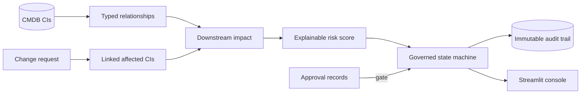

# ⚙️ Mini-ITSM — Change Control Command Center

A scoped, working analogue of the ServiceNow mechanics most relevant to data-center operational change control: a **CMDB dependency graph**, **impact-aware risk scoring**, an **enforced change state machine**, **approval gates**, and a reconstructable **audit trail**.

> **Scope honesty:** This is an interview-engineering and learning demo, not a replacement for ServiceNow. It isolates core governance mechanics in a compact Python/SQLite/Streamlit system.

## Live demo

**Streamlit Community Cloud:** `[URL added after deployment]`

## 30-second pitch

Mini-ITSM models a small data-center power chain—site → generator → UPS → PDU → server—as Configuration Items with typed, directional relationships. A change links to affected CIs, walks the graph to calculate downstream blast radius, and combines that with CI criticality and change type to produce an explainable risk score. The workflow enforces Draft → Assess → Authorize → Scheduled → Implement → Review → Closed, blocks scheduling until approval records pass, and audits every consequential action.

## Architecture



## Real ServiceNow mapping

| Mini-ITSM | ServiceNow analogue | Concept |
|---|---|---|
| `cmdb_ci` + `ci_type` | `cmdb_ci` class hierarchy | Configuration Items as operational context |
| `cmdb_rel` | `cmdb_rel_ci` | Typed, directional dependencies |
| `downstream_impact()` | Dependency Views / impact analysis | Blast radius for risk and planning |
| Explicit `TRANSITIONS` graph | Change Management + Flow Designer/state model | State is governed, not cosmetic |
| Deterministic risk scorer | Change Risk Assessment | Explainable decision support |
| `change_approval` gate | Approval records / CAB workflow | Scheduling cannot bypass authorization |
| `audit_log` | `sys_audit`-style history | Who changed what, when, and why |

## Demo walkthrough (3 minutes)

1. Open **CMDB impact**, select `UPS-01`, and show downstream PDUs/servers.
2. Open `CHG1000001` in **Change workflow**; it is deliberately parked in **Authorize** with a high risk score.
3. Click **Move to Scheduled** before approval—the backend blocks the transition.
4. Approve the pending CAB record, then schedule successfully.
5. Open **Audit trail** and show that CI links, transitions, and decisions are reconstructable.
6. Use **Reset deterministic demo** to return the session to its original state.

## Why the governance belongs in the backend

The Streamlit UI is deliberately thin. It calls the same `itsm.change` functions used by the CLI and tests, so a UI callback cannot bypass transition or approval rules. The strongest design sentence is:

> The system does not merely display that approval is required; the state machine refuses scheduling until approval records prove the gate passed.

## Local setup

```bash
python3 -m venv .venv
. .venv/bin/activate
pip install -r requirements.txt
python -m pytest -q
streamlit run streamlit_app.py
```

CLI walkthrough:

```bash
python -m itsm.cli seed
python -m itsm.cli cmdb-impact PDU-01
python -m itsm.cli change-show CHG1000001
```

## Tests

The backend suite covers:
- deterministic CMDB topology and dependency traversal;
- illegal state-transition rejection;
- scheduling blocked without full approval;
- rejection overriding other approvals;
- risk changing with criticality and blast radius;
- audit-trail completeness;
- the full lifecycle to a terminal Closed state.

```bash
python3 tests/test_itsm.py
# 8/8 tests passed
```

## Repository layout

```text
streamlit_app.py       Streamlit Community Cloud entry point
itsm/db.py             SQLite schema and connection layer
itsm/cmdb.py           CI records, relationships, impact traversal, seed topology
itsm/change.py         State machine, risk, approvals, audit trail
itsm/demo.py           Deterministic interview scenarios
itsm/ui/app.py         Session-isolated Streamlit operations console
itsm/cli.py            CLI lifecycle driver
tests/test_itsm.py     Backend behavior tests
docs/NOTES.md          Detailed ServiceNow/interview mapping
```

## Production evolution

Use ServiceNow/enterprise CMDB integration instead of a duplicate source of truth; authenticated APIs and RBAC; configurable workflow definitions; notifications and SLA timers; discovery/reconciliation and CI data-quality controls; concurrent-change detection; maintenance windows; rollback/validation tasks; customer/SLA impact; and dashboards tracking change success, rollback rate, incidents caused by change, emergency-change rate, unauthorized changes, approval lead time, and repeat failures.
